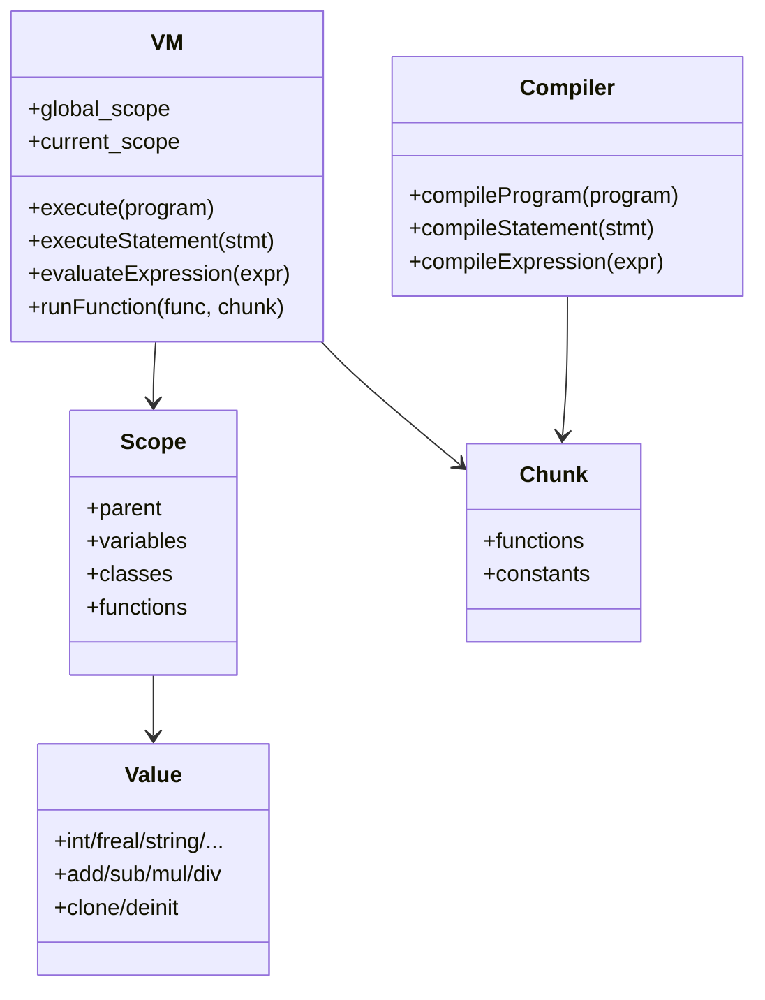
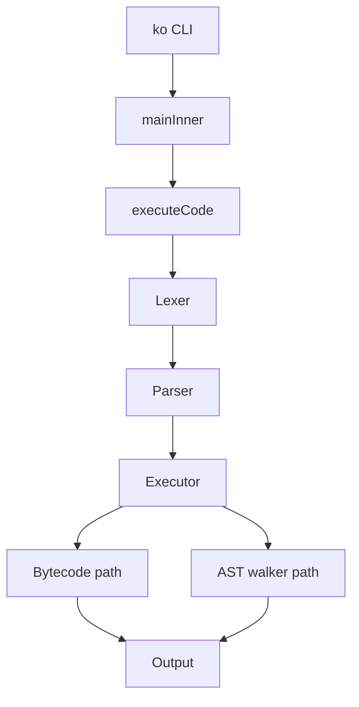

# Overview — compiler_ko (.ko language)

## 1. Mục đích repo

`compiler_ko` là triển khai ngôn ngữ `.ko` bằng Zig, kèm các thành phần phụ trợ viết bằng C++ (`Loop.cpp`), Java (`Import.java`), Python (`api_server.py`) và các module C (`Os`, `Random`, `Website`). Repo gồm frontend (lexer/parser/AST), middle/backend (compiler bytecode + VM), package manager/installer, Module Store API và các module native.

## 2. Kiến trúc tổng thể

```mermaid
flowchart LR
    A[Source .ko] --> B[Lexer (Zig)]
    B --> C[Parser (Zig)]
    C --> D[AST (ast.zig)]
    D --> E{Executor}
    E -->|không func/class/import| F[Compiler (bytecode)]
    F --> G[Bytecode VM]
    E -->|có func/class/import| H[AST-walking VM]
    H --> I[Output]
    G --> I
    D --> J[Import.java / module store]
    H --> K[Loop.cpp (libko_loop.so)]
```

Pipeline thực thi trong `executeCode` (`src/main.zig`):

1. `lexer.Lexer.init(source)` + `tokenize`.
2. `parser.Parser.init(...)` + `parse()`.
3. `executor_mod.Executor.init(...)` + `execute(program)`.
4. `Executor.execute` chọn bytecode nếu không có func/class/import; ngược lại dùng AST walker.

## 3. Cây file chính

| File | Vai trò |
|---|---|
| `src/main.zig` | CLI, entry point, dispatch lệnh, REPL, executeCode |
| `src/lexer.zig` | Tokenizer cho ngôn ngữ .ko |
| `src/parser.zig` | Parser chính, statement-level |
| `src/parser_expr.zig` | Parser biểu thức theo precedence |
| `src/ast.zig` | Định nghĩa node AST và deinit |
| `src/compiler.zig` | Biên dịch AST -> bytecode |
| `src/bytecode.zig` | Opcodes, `Instruction`, `Function`, `Chunk` |
| `src/executor.zig` | Chọn backend bytecode/AST walker |
| `src/vm.zig` | VM AST-walking + bytecode runner + scope |
| `src/vm_value_ops.zig` | Evaluate expression, call, import, printf, system tags |
| `src/value.zig` | Value, Scope, Function, ClassDef, ClassInstance, operators |
| `src/operator.zig` | Áp dụng toán tử binary/unary, map opcode |
| `src/builtins.zig` | Đăng ký builtin (hiện rỗng) |
| `src/installer.zig` | Package manager + Firestore client |
| `src/api_server.py` | Local Module Store REST server |
| `src/Loop.cpp` | C++ loop optimization engine (`libko_loop.so`) |
| `src/Import.java` | Java module import subsystem (reference) |
| `src/module/*` | Module C builtin: Os, Random, Website |
| `build.zig` | Build Zig + shared libs + tests |
| `testing/*` | Test suites lex/parse/vm/module |

## 4. Chi tiết từng file và hàm

### 4.1 `src/main.zig`

- `scanModuleStore(allocator, io)`: đọc `src/module/*/module.json`, trả `[]ModuleManifest`.
- `unsupportedShell(...)`: báo lỗi shell không hỗ trợ.
- `generateBashCompletion`, `generateZshCompletion`, `generateFishCompletion`: sinh script completion.
- `printUsage`, `printHelp`: in hướng dẫn.
- `main(it)`: bắt lỗi top-level, gọi `mainInner`, exit code.
- `mainInner(it)`: parse args, xử lý `--version`, `--help`, `-install`, `-list`, `-plugins`, `-search`, `run`, `build`, `repl`, `--generate-completion`, default file.
- `scanPluginDir(writer, io, path)`: quét thư mục plugin và manifest.
- `readSourceFile(allocator, io, path)`: đọc file nguồn.
- `executeCode(allocator, io, source, source_name)`: lex -> parse -> execute, báo lỗi.
- `runRepl(allocator, io)`: REPL đọc dòng, theo dõi depth bracket `[...]`, tích lũy đến khi depth <= 0 rồi execute.
- `isFilePath(io, arg)`: kiểm tra arg là file path.

### 4.2 `src/lexer.zig`

Kiểu và hàm:

- `Token` union: eof, identifier, int_lit, freal_lit, string_lit, bool_true/false, byte_lit, bytes_lit, brackets/parens/braces, priority_lit, sigil, dollar, lt, gt, caret, amp_amp, logical_or, at, bang, colon, comma, dot, plus, minus, star, bold_lit, slash, percent, equals, amp_equals, keyword.
- `Keyword` enum + `keywordText`.
- `KeywordMap`: map từ text sang keyword.
- `Position`: line/col/column/offset.
- `Lexer.init(source)`: khởi tạo.
- `Lexer.next()`: trả token tiếp theo; xử lý whitespace, comment `|...|`, string `'...'/"..."`, backtick identifier, số, từ khóa, sigil `$`, `**Loop**`/`**Import**`, escape `\True\`.
- `Lexer.tokenize(allocator)`: trả tokens + positions.

Thuật toán quan trọng: quét ký tự từng bước, phân biệt token đa ký tự (`&&`, `%%`, `&=`, `**...**`), comment dạng `|...|`, số thực/int.

### 4.3 `src/parser.zig` + `src/parser_expr.zig`

- `Parser.init`: khởi tạo parser với tokens/positions/arena.
- `current`, `advance`, `peek`, `isAtEnd`, `currentSpan`.
- `parse`: parse toàn bộ program thành `[]ast.Statement`, xử lý lỗi/synchronize.
- `parseStatement`: điều phối parse statement theo token hiện tại.
- `parseVarDecl`, `parseAssignment` (trong expr), `parseFuncDecl`, `parseClassDecl`, `parseImportStmt`, `parseLoopStmt`, `parseIfStmt`, `parseElifStmt`, `parseElseStmt`, `parseReturnStmt`, `parseCatchStmt`, `parseNowStmt`, `parseMemoryOpStmt`, `parseEncodingOpStmt`, `parseLenOpStmt`, `parseInputStmt`, `parsePrintfStmt`, `parseSystemTagStmt`, `parseClassInstantiation`, `parseBlock`, `parseBlockStatement`, `parseExprStatement`.
- `parseExpression` precedence chain trong parser_expr:
  - `parseOrExpr` (`%%`)
  - `parseAndExpr` (`&&`)
  - `parseEqualityExpr` (`==`, `!=`)
  - `parseRelationalExpr` (`<`, `>`, `<=`, `>=`)
  - `parseAdditiveExpr` (`+`, `-`)
  - `parseMultiplicativeExpr` (`*`, `/`, `%`)
  - `parseUnaryExpr` (`-`, `!`/not)
  - `parsePrimaryExpr`: literal, identifier, parenthesized expr, system tag, index/member access.
  - `parseSystemTagExpr`, `parseIndexAccessSuffix`.
- `makeIfStmt`, `makeElifStmt`, `makeElseStmt`, `makeReturnStmt`, `makeCatchStmt`, `makeNowStmt`, `makeLoopStmt`, `makeMemoryOp`, `makeEncodeOp`.
- `expect*`: kiểm tra token bắt buộc.

Thuật toán: recursive descent parser theo precedence; statement-level dispatch; block sort theo priority; error recovery qua `synchronize` và `isStatementStart`.

### 4.4 `src/ast.zig`

Định nghĩa AST union/struct:

- `Statement` union: var_decl, assignment, func_decl, class_decl, control_flow, memory_op, encoding_op, len_op, return_stmt, expr, catch_stmt, block, class_instantiation, priority_stmt.
- `Expr` union: literal, identifier, binary, unary, call, member_access, index_access, system_tag, input_expr, now_expr.
- `ControlFlow`, `Elif`, `FuncDecl`, `ClassDecl`, `VarDecl`, `Assignment`, `MemoryOp`, `EncodingOp`, `LenOp`, `ReturnStmt`, `CatchStmt`, `BlockStmt`, `ClassInstantiation`, `PriorityStmt`, `DictEntry`, `Literal`, `BinaryExpr`, `UnaryExpr`, `CallExpr`, `MemberAccess`, `IndexAccess`, `SystemTagExpr`, `InputExpr`, `NowExpr`.
- Mỗi node có `deinit` giải phóng bộ nhớ.

### 4.5 `src/compiler.zig`

- `Compiler.init`: tạo function entry trong chunk.
- `Compiler.compileProgram`: compile từng statement rồi emit `ret`.
- `compileStatement`: dispatch theo loại statement.
- `compileControlFlow`: compile if/elif/else và for/while bằng jump placeholder + patch.
- `compileMemoryOp`, `compileEncodingOp`, `compileLenOp`, `compileClassInstantiation` (unsupported).
- `compileExpression`: compile literal, identifier, binary, unary, call, input_expr, system_tag.
- `compileVarDecl`, `compileAssignment`, `compileReturn`, `compileCatch`, `compileFuncDecl`.
- `emitJumpPlaceholder`, `patchJump`: backpatch jump offset.
- `emitLiteral`: xử lý literal, dict entries.
- `emit`, `unescapeString`.

Thuật toán: stack-based bytecode generation, jump backpatching cho control flow.

### 4.6 `src/bytecode.zig`

- `Op` enum: load_const, load_var, store_var, binary, unary, jump, jump_if_false, call, call_method, ret, print, input, now, len, memory, encode, make_dict, dict_set, catch_start, catch_end, import.
- `Instruction` union payload.
- `Function`: name, instructions, arity.
- `Chunk`: functions + constants, init/deinit.

### 4.7 `src/executor.zig`

- `Backend` enum: bytecode, ast_walker.
- `Executor.init`: tạo VM nếu chưa inject.
- `Executor.deinit`.
- `Executor.backend`.
- `Executor.execute`: nếu không có func/class/import thì compile bytecode và chạy; nếu lỗi hoặc unsupported thì fallback AST walker.
- `hasImportStmt`, `hasFuncOrClassDef`: quét program để quyết định backend.

### 4.8 `src/vm.zig`

Cấu trúc `VM` và hàm:

- `init`, `setInputBuffer`, `setOutputWriter`, `stdinReader`, `readInputLine`, `stdoutWriter`, `appendValueToString`, `deinit`.
- `getProcessName`, `exposeProcess`.
- `execute`: sort statement theo priority (insertion sort), chạy từng statement, catch global.
- `dispatchCatchBlocks`: tìm catch statement sau lỗi.
- `executeStatement`: xử lý mọi loại statement AST, class/function, control flow, memory/encoding/len, return, block, catch, priority.
- `executeBlock`: sort priority rồi execute.
- `executeStatementInScope`: đổi scope tạm thời.
- `assignValue`: gán biến/field/index/dict.
- `zigErrorToKoType`, `raiseError`.
- `evaluateExpression` và các wrapper evaluate*.
- `dispatchLoop`: nạp `libko_loop.so`, optimize/execute loop C++ (body rỗng, chỉ benchmark/side-effect).
- `executeChunk`, `runFunction`: bytecode stack machine.
- `binaryOp`, `evaluateUnaryOp`, `callBuiltin`.

### 4.9 `src/vm_value_ops.zig`

- `appendValueToString`
- `evaluateExpression`: dispatch theo Expr.
- `unescape`
- `evaluateLiteral`, `evaluateIdentifier`, `evaluateBinary`, `printInterpolated`
- `evaluateUnary`, `instantiateClassByName`
- `callUserFunction`, `callUserFunctionValues`
- `evaluateCall`: xử lý `Loop`, `Import`, `printf`, function/class call.
- `evaluateMemberAccess`, `evaluateIndexAccess`
- `evaluateSystemTag`: xử lý `Loop`, `printf`, `len`, `type`, `memory`, `encode`.
- `evaluateInput`, `evaluateNow`
- `binaryOp`, `evaluateUnaryOp`, `callBuiltin`
- `zigErrorToKoType`

Thuật toán Import: tìm module trong `./libs`, `~/.ko/plugins`, `zig-out/lib` với nhiều tên file candidate; nếu không load được native thì đọc metadata `src/module/<name>/module.json`; đăng ký biến scope `module:<name>`.

### 4.10 `src/value.zig`

- `Value` union + `deinit`, `format`, `print`, `toBool`, `equals`, `add/sub/mul/div/rem`, `less/greater/lessOrEqual/greaterOrEqual`, `clone`.
- `Function`, `Param`, `ClassInstance`, `ErrorObj`.
- `Scope`: init/deinit, variables/classes/functions + parent.
- `ClassDef`: private/public fields/methods + scopes, deinit.

### 4.11 `src/operator.zig`

- `applyBinary`: dispatch operator sang `Value.add/sub/...` hoặc so sánh/logic.
- `applyUnary`: neg/not.
- `binaryToOpcode`, `binaryFromOpcode`, `unaryToOpcode`, `unaryFromOpcode`.
- `applyBinaryOpcode`, `applyUnaryOpcode`.

### 4.12 `src/builtins.zig`

- `registerBuiltins(scope)`: hiện chưa đăng ký builtin nào.

### 4.13 `src/installer.zig`

- `getApiKey`: đọc `KO_FIRESTORE_API_KEY`.
- `Installer.init/deinit`.
- `installLibrary`: validate tên, query metadata, clone, inspect zip, detect language, compile/link, register scope.
- `listLibraries`: POST runQuery qua curl.
- `searchLibraries`: filter substring.
- `queryLibraryMetadata`: GET metadata.
- `cloneRepo`, `inspectAndFilterZip`, `detectLanguage`, `compileAndLink`, `registerScope`, `validateZipEntries`, `runCommand`, `cleanup`, `extractStringField`.

Thuật toán installer: validate tên thư viện, gọi Firestore API, clone repo, kiểm tra `.zip`, giải nén, detect ngôn ngữ theo extension, compile theo ngôn ngữ, tạo manifest `src/module/<lib>/module.json`, cleanup khi lỗi.

### 4.14 `src/api_server.py`

- `ModuleStore`: load/save `libraries.json`, default libs Random/Os/Website/Math, list/get/register.
- `RequestHandler`: rate limit 120 req/min/IP, API key check, GET library, POST runQuery, PUT register, OPTIONS.
- `main`: argparse `--port`, `--data-dir`, `--host`.

### 4.15 `src/Loop.cpp`

- Namespace `ko_loop`: `LoopUnroller`, `LoopRecord`, `CpuCounterRegisters`, `OptimizationStrategy`.
- `recordFor`: validate step>0 và start<=end, tính count, chọn strategy theo count.
- `recordWhile`: lưu condition fn/context.
- `executeForLoop`: thực thi for loop với unroll chunk.
- `executeWhileLoop`: thực thi while loop bounded bởi maxIterations, trả true nếu dừng bởi condition.
- `executeOptimized`: tìm loop trong cache, gọi for/while.
- C ABI: `ko_loop_engine_create`, `destroy`, `ko_loop_optimize_for`, `ko_loop_optimize_while`, `ko_loop_execute_optimized_loop`, `ko_loop_execute_while_loop`, `ko_loop_get_stats`, `ko_loop_reset_registers`.
- `main`: demo CLI.

### 4.16 `src/Import.java`

- `Import` constructor: tempDir + libraryDir.
- `processImport(moduleName, alias, scopeTag)`: normalize, query registry, clone, inspect zip, compile/link, cleanup.
- `queryRegistry`, `listLibraries`, `searchLibraries`.
- `cloneRepository`, `inspectAndExtractZip`, `findZipRecursive`, `deleteNonZipFilesRecursive`.
- `compileAndLink`: detect language và gọi compileJava/C/Cpp/NodeJs/Zig/Ko.
- `compileJava`, `compileC`, `compileCpp`, `compileNodeJs`, `compileZig`, `compileKo`.
- `detectLanguage`, `findMainFile`, `collectFiles`, `writeModuleManifest`, `copyFile`, `normalizeModuleName`.
- `extractZipSafely`: chống ZipSlip.
- `isValidName`, `cleanup`, `deleteRecursive`, `readFile`, `readStream`, `extractJsonField`, `findUnescapedQuote`, `extractLibraryNames`, `findMatchingBrace`.
- `ImportResult` record success/error.
- `main`: CLI import/list/search.

### 4.17 Module C

- `src/module/Os`: env, file exists/size, cwd, exec (fork/execvp có timeout 5s, kiểm tra metachar), exit, list_dir (chưa implement).
- `src/module/Random`: LCG-like PRNG thread-safe bằng atomic CAS, seed, float, bytes.
- `src/module/Website`: HTTP request placeholder chưa implement, URL encode/decode/validate (chặn metachar/path traversal/dangerous scheme).

### 4.18 `build.zig`

- Build executable `ko` từ `src/main.zig`.
- Build shared libs `ko_os`, `ko_random`, `ko_website`, `ko_loop`.
- Build `mod_check` (link libdl).
- Test step chạy `testing/test_harness.zig` (các test khác bị comment).

## 5. Thuật toán chính

### 5.1 Lexing

- Quét từng char, phân loại token.
- Comment `|...|` bị bỏ qua.
- String literal hỗ trợ escape.
- Bold literal `**Loop**`/`**Import**` cho từ khóa đặc biệt.
- Priority `{n}` trong block.

### 5.2 Parsing precedence

Biểu thức parse theo thứ tự từ thấp đến cao:

`or (%%)` -> `and (&&)` -> `equality (==, !=)` -> `relational (<,>,<=,>=)` -> `additive (+,-)` -> `multiplicative (*,/,%)` -> `unary (-, not)` -> `primary`.

### 5.3 AST walking VM

- Scope chain: current -> parent -> global.
- Function call tạo scope mới với closure_scope parent.
- Class declaration tạo ClassDef, private/public scope.
- If/elif/else dùng `skip_elif_else` flag.
- For loop: init -> condition -> body -> step -> condition.
- Priority sort statement dùng insertion sort.

### 5.4 Bytecode VM

- Stack machine với stack cố định 1024.
- `load_const`, `load_var`, `store_var`, `binary`, `unary`, jump, call, print, input, now, len, memory, encode, dict.
- Backend bytecode chỉ dùng khi program không có func/class/import.

### 5.5 Loop optimization (C++)

- Cache loop theo id.
- For loop: unroll factor 4/8 theo count, bounded maxIterations.
- While loop: condition callback, bounded maxIterations, trả lỗi nếu vượt cap.
- Thread yield mỗi unroll factor.

### 5.6 Module import (Zig)

- Dynamic load `.so` từ nhiều thư mục.
- Fallback metadata từ `src/module`.
- Đăng ký biến marker `module:<name>`.

### 5.7 Installer

- Validate tên.
- Query Firestore metadata.
- Clone repo, kiểm tra zip, giải nén.
- Detect language theo extension.
- Compile theo ngôn ngữ.
- Register scope tạo manifest.

### 5.8 API server

- In-memory JSON store.
- Rate limit sliding window 60s.
- API key HMAC compare.
- Endpoint Firestore-compatible.

## 6. Sơ đồ thành phần





## 7. Test và build

- `build.zig` build `ko`, shared libs, `mod_check`.
- Test step chỉ enable `testing/test_harness.zig`; các test khác bị comment.
- Test files: `test_3600.zig`, `test_lexer_extended.zig`, `test_parser_extended.zig`, `test_modules.zig`, `test_value.zig`, `test_harness.zig`.
- `testing/mod_check.c` kiểm ABI module `.so`.

## 8. Ghi chú

- Nhiều phần module/HTTP chưa implement (`ko_http_request`, `ko_list_dir`).
- `builtins.zig` chưa đăng ký builtin.
- Bytecode backend không hỗ trợ class declaration/instantiation.
- Java Import là reference implementation, không tích hợp trực tiếp vào Zig runtime.
- Loop C++ được gọi nhưng body rỗng; chủ yếu side-effect/benchmark.
- API server dùng file JSON local, không phải Firestore thật.
